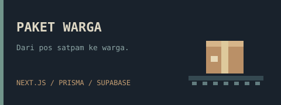
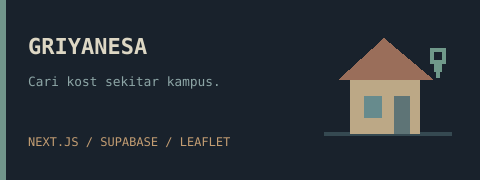
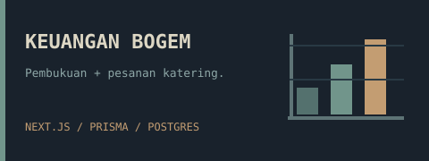
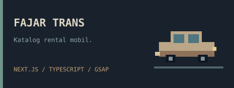
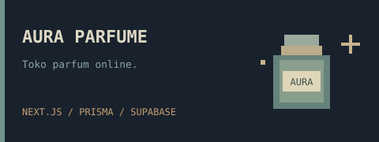
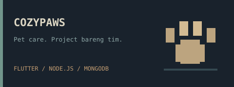

  

### Halo, aku Argandhi.

Mahasiswa Informatika UNESA, asal **Madiun, Jawa Timur**.

Biasanya bikin web pakai **Next.js dan TypeScript**. Ada juga project **Flutter**, sama beberapa eksperimen **Python** buat kuliah. Di sini aku simpan project pribadi, tugas, dan hasil kerja bareng teman.

### Project

Klik kartunya buat buka repo.

<table>
<tr>
<td width="50%"></td>
<td width="50%"></td>
</tr>
<tr>
<td width="50%"></td>
<td width="50%"></td>
</tr>
<tr>
<td width="50%"></td>
<td width="50%"></td>
</tr>
</table>

Project lainnya

- [Portfolio + CMS](https://github.com/Argandhi23/portofolio)
- [Prabaswara — web studio fotografi](https://github.com/Argandhi23/prabaswara)
- [Vetsy — aplikasi kesehatan hewan](https://github.com/Argandhi23/vetsy-app), project tim
- [GoTo Pulse — analisis sentimen review](https://github.com/Argandhi23/goto-pulse)
- [Klasifikasi ulasan Tokopedia](https://github.com/Argandhi23/submission_sentimen_tokopedia), eksperimen IndoBERT dan CNN
- [Next.js / SSR](https://github.com/Argandhi23/next-metopen) dan [React / CSR](https://github.com/Argandhi23/react-metopen), penelitian performa web

### Yang sering dipakai

`Next.js` `React` `TypeScript` `Tailwind CSS`  
`Flutter` `Dart` `Node.js` `Prisma`  
`Supabase` `PostgreSQL` `MongoDB` `Python`

### Commit

[Semua repo →](https://github.com/Argandhi23?tab=repositories)
