**🌏 Ngawi, Indonesia · 🎓 Informatika UNESA · 🛠️ Web & Mobile**

[🚀 Lihat project](#-beberapa-yang-aku-bikin) · [🧰 Isi toolbox](#-isi-toolbox-ku) · [🐍 Kasih makan ular](#-commit-dulu-dimakan-ular-kemudian)

### 👋 Kenalan dulu, yuk

Panggil aja **Argandhi**. Aku suka ngulik ide terus nyobain bikin aplikasinya—mulai dari web buat bisnis lokal, sistem buat warga, sampai aplikasi pet care.

Paling sering main sama **Next.js + TypeScript**, kadang pindah ke **Flutter**, kadang nyasar ke **Python & AI**. Repo di sini isinya campuran project pribadi, kerja bareng tim, dan tugas kuliah yang sekalian jadi tempat eksperimen 😄

### 🧰 Isi toolbox-ku

Selain itu juga pernah ngulik **Node.js, PostgreSQL, MongoDB, Tailwind CSS, GSAP, Vitest, dan Playwright**. Pilih alatnya sesuai project, sambil belajar hal baru di jalan 🔧

### 🚀 Beberapa yang aku bikin

Klik judulnya kalau mau ngintip kodenya 👇  
Ada yang personal, ada yang dikerjain bareng tim. Cerita lengkapnya ada di repo masing-masing.

<table>
<tr>
<td width="50%" valign="top">
<h3>📦 <a href="https://github.com/Argandhi23/sistem-paket-warga">Paket datang? Biar kecatat.</a></h3>
<b>Sistem Paket Warga</b> — alur paket dari satpam sampai warga, lengkap sama dashboard dan update realtime.
  <code>Next.js</code> <code>Prisma</code> <code>Supabase</code>
</td>
<td width="50%" valign="top">
<h3>🏡 <a href="https://github.com/Argandhi23/griyanesa">Cari kost dekat kampus</a></h3>
<b>Griyanesa</b> — cari kost sekitar UNESA Kampus 5 lewat peta, terus lanjut booking via WhatsApp.
  <code>Next.js</code> <code>Supabase</code> <code>Leaflet</code>
</td>
</tr>
<tr>
<td width="50%" valign="top">
<h3>🍱 <a href="https://github.com/Argandhi23/sistemkeuanganbogem">Pesanan masuk, kas keurus</a></h3>
<b>Keuangan Bogem</b> — pembukuan dan pesanan katering BUMDes, plus laporan dan integrasi Google Sheets.
  <code>Next.js</code> <code>Prisma</code> <code>PostgreSQL</code>
</td>
<td width="50%" valign="top">
<h3>🚗 <a href="https://github.com/Argandhi23/fajartrans">Mau jalan ke mana?</a></h3>
<b>Fajar Trans</b> — website rental mobil dengan katalog armada, animasi, dan pemesanan via WhatsApp.
  <code>Next.js</code> <code>TypeScript</code> <code>GSAP</code>
</td>
</tr>
<tr>
<td width="50%" valign="top">
<h3>🛍️ <a href="https://github.com/Argandhi23/auraparfume">Ngoding yang wangi-wangi</a></h3>
<b>AURA Parfume</b> — toko parfum online, dari katalog dan checkout sampai pengelolaan pesanan.
  <code>Next.js</code> <code>Prisma</code> <code>Supabase</code>
</td>
<td width="50%" valign="top">
<h3>🐾 <a href="https://github.com/Argandhi23/cozypaws">Buat si kaki empat</a></h3>
<b>Cozypaws</b> — project tim aplikasi pet care, buat profil pengguna, appointment, dan review layanan.
  <code>Flutter</code> <code>Node.js</code> <code>MongoDB</code>
</td>
</tr>
</table>

<b>🧪 Masih ada eksperimen lain, buka sini!</b>

- 🧑‍🚀 [Portfolio + CMS](https://github.com/Argandhi23/portofolio) — tempat ngumpulin karya, sekalian bikin pengelola kontennya sendiri.
- 📷 [Prabaswara](https://github.com/Argandhi23/prabaswara) — web studio fotografi dengan portofolio dan CMS.
- 📱 [Vetsy](https://github.com/Argandhi23/vetsy-app) — project tim Flutter buat profil hewan dan riwayat medis.
- 💬 [GoTo Pulse](https://github.com/Argandhi23/goto-pulse) — ngulik sentimen dari review Gojek dan Tokopedia.
- 🤖 [Sentimen Tokopedia](https://github.com/Argandhi23/submission_sentimen_tokopedia) — eksperimen klasifikasi ulasan pakai IndoBERT dan CNN.
- ⚡ [Next.js / SSR](https://github.com/Argandhi23/next-metopen) vs [React / CSR](https://github.com/Argandhi23/react-metopen) — bahan penelitian performa web dan SEO.

### 🐍 Commit dulu, dimakan ular kemudian

*Si ular kebagian kotak, aku kebagian pengalaman debugging 😅*

 

**Penasaran sama project lainnya?**  
[📂 Buka semua repo-ku](https://github.com/Argandhi23?tab=repositories)

 

