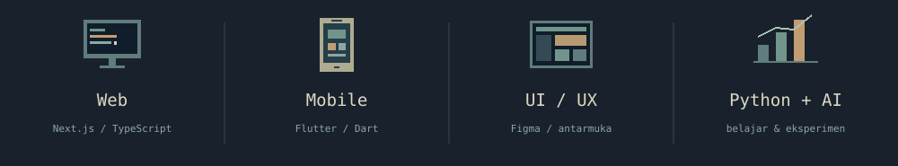

  

 

Aku **Argandhi**, dari **Madiun**. Sekarang kuliah Informatika di **Universitas Negeri Surabaya**.

Aku suka ngulik web, aplikasi mobile, dan tampilan antarmuka. Paling sering ketemu **Next.js sama TypeScript**, tapi juga main **Flutter** dan belajar **Python & AI**.

### Yang suka aku ulik

 

Isi toolbox-ku

**Web** — Next.js, React, TypeScript, JavaScript, Tailwind CSS  
**Mobile** — Flutter, Dart  
**Backend & database** — Node.js, Prisma, Supabase, PostgreSQL, MongoDB  
**Lainnya** — Python, Figma, Git, Postman, Vitest, Playwright

### Jejak di sini

  <a href="https://github.com/Argandhi23">GitHub</a>

